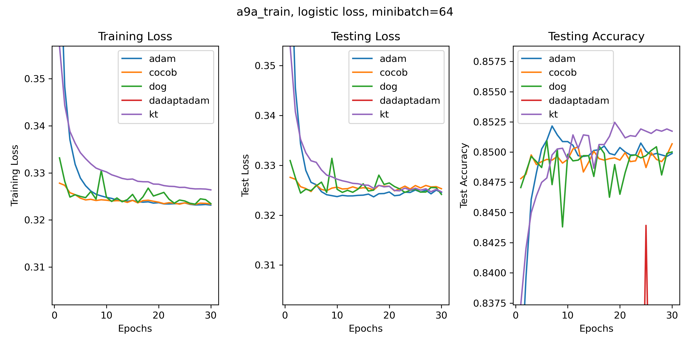
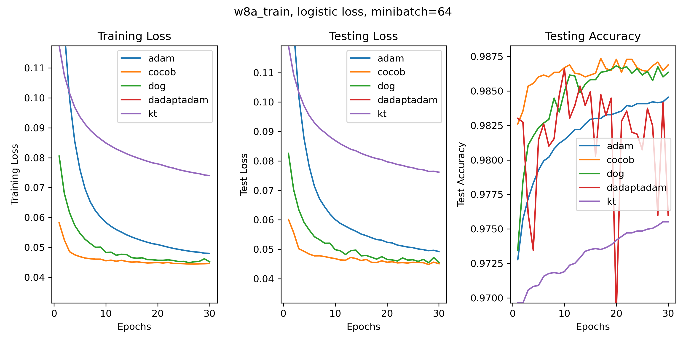

<!--
Copyright (c) 2023, 2024, 2026 Francesco Orabona
Licensed under the MIT License. See LICENSE in the project root.
-->

# Parameter-Free
Parameter-Free Optimizers for PyTorch

This is a library for parameter-free optimization in PyTorch. Parameter-free is a technical term that denotes a certain ability of an optimization algorithm to adapt to the unknown distance to the optimal solution. But in practice it means ``SGD without learning rates'' :)

## Installation
To install the package, simply run `pip install parameterfree`.

## Usage

All optimizers use the standard PyTorch optimizer interface. Initialize the
model and move it to its device before constructing the optimizer, so its
initial parameters become the fixed anchor:

```python
import torch
from parameterfree import COCOB, KT, cKT, ConicFTRL, CoordinateWise

model = torch.nn.Linear(10, 1)
optimizer = COCOB(model.parameters())

optimizer.zero_grad()
loss = model(torch.randn(8, 10)).square().mean()
loss.backward()
optimizer.step()
```

Choose the constructor for the algorithm you want; the training loop is the same:

| Algorithm | Constructor | Required effective-gradient bound |
| --- | --- | --- |
| COCOB | `COCOB(model.parameters())` | None |
| KT | `KT(model.parameters(), max_grad_norm=1.0)` | Global L2 norm at most 1 |
| cKT | `cKT(model.parameters(), max_grad_norm=1.0)` | Each coordinate in `[-1, 1]` |
| ConicFTRL | `ConicFTRL(model.parameters())` | None |
| Coordinate-wise ConicFTRL | `CoordinateWise(ConicFTRL, model.parameters())` | None |

`cKT(params, ...)` is shorthand for `CoordinateWise(KT, params, ...)`. The
wrapper runs independent scalar learners using batched tensor operations, with
no optimizer objects or Python loops per weight. The FashionMNIST script calls
the coordinate-wise ConicFTRL variant `cConicFTRL`.

COCOB defaults to `alpha=100` (initial stabilization) and `eps=1e-8` (numerical
stability). KT and cKT default to initial wealth `w=1e-4`. ConicFTRL defaults to
`epsilon=1.0` (initial loss budget, not a numerical stabilizer) and `gamma=1.0`
(regularization tradeoff). In coordinate-wise mode, `w` and `epsilon` are
**per-coordinate** budgets; divide a total budget by
`d = sum(p.numel() for p in model.parameters())` to split it across weights.

### Shared options

| Option | Default | Behavior |
| --- | --- | --- |
| `weight_decay` | `0.0` | Adds an L2 penalty to the gradient. |
| `compile` | `False` | Uses `torch.compile` to fuse optimizer updates (PyTorch 2+); first use includes compilation. |
| `error_if_nonfinite` | `True` | Checks gradients and candidate state before committing updates; adds a synchronization on CUDA. Set to `False` to omit these checks. Vector ConicFTRL retains its own scalar-state checks. |

Pass these options to any constructor above, including `CoordinateWise`.
COCOB, KT, and cKT also accept `foreach=None`, selecting multi-tensor operations
on CUDA and per-tensor operations on CPU. `True` forces multi-tensor execution;
`False` keeps per-tensor execution. COCOB's foreach path requires one dtype/device;
automatic selection falls back for heterogeneous parameters. `CoordinateWise`
accepts `foreach` and uses the supplied rule's execution paths; ConicFTRL uses
its packed update and has no `foreach` constructor option. Execution paths may
differ in floating-point rounding; benchmark them on the target device.

Parameter groups can set `lr` (initially 1) and `weight_decay`. Schedulers work
by scaling gradients through `lr`. KT/cKT also accept `max_grad_norm` (default
`None`); the constructors above enable global L2/Linf clipping, respectively.
Clipping precedes weight decay and gradient scaling, so those transformations
must still respect KT's effective-gradient bound. With `weight_decay=0` and
`lr <= 1`, `max_grad_norm=1.0` enforces the bound. Updates do not modify `p.grad`.

### State and zero gradients

KT, cKT, ConicFTRL, and `CoordinateWise` require dense float32 or float64
parameters of one dtype on one device, with the parameter set fixed at
construction. Floating state uses the parameter dtype; KT counters use int64.
Float32 models use float32 reductions and tensor root solves. Eager vector
ConicFTRL solves its scalar equation in Python double precision on the CPU,
then stores the result in the parameter dtype. The batched backend does not
support float16/bfloat16 parameters or introduce automatic mixed precision.

Vector KT and ConicFTRL share state across all parameters. An entirely zero or
missing effective gradient leaves parameters and state unchanged. Individual
zero or missing components can still move when other components are nonzero.
COCOB pauses tensors with missing gradients. Coordinate-wise learners pause
missing or zero effective coordinates independently, including cKT's wealth
and per-coordinate round counters. Zero detection follows clipping, decay, and
`lr` scaling, so a zero raw gradient with nonzero weight decay need not be
skipped. Checkpoint loading retains stored counters; future zero rounds follow
this policy.

## Details

There have been many parameter-free algorithms proposed over the past 10 years.
Some of them work very well, even winning Kaggle competitions, some others are mainly interesting from a theoretical point of view.
However, the original code of many of these algorithms got lost or the authors stopped maintaining them.
This also makes it difficult to compare recent algorithms with previous variants.

Moreover, people in this field know that it is possible to combine tricks and reductions, like LEGO blocks, to obtain even more powerful parameter-free algorithms. For example, any online convex optimization algorithm can be made coordinate-wise just running an independent copy on each coordinate.
However, there is essentially no code available, but only long papers full of math :)

So, I decided to write a single library to gather all the parameter-free algorithms I know and possibly of some interesting and easy to obtain variants.
I'll add them slowly over time.
Here the current implemented algorithms:

- **COCOB** This is the first parameter-free algorithms specifically designed for deep learning. The [original code](https://github.com/bremen79/cocob) was in Tensorflow. It was used to win a [Kaggle competition](https://github.com/Arturus/kaggle-web-traffic/tree/master). The paper is 
*Francesco Orabona, Tatiana Tommasi. Training Deep Networks without Learning Rates Through Coin Betting.
 [NeurIPS'17](https://arxiv.org/abs/1705.07795)*

- **KT** First parameter-free algorithm based on the coin-betting framework. Code never released. This is the simplest version of parameter-free algorithms, do not expect state-of-the-art performance. The paper is
*Francesco Orabona, Dávid Pál. Coin Betting and Parameter-Free Online Learning.
 [NeurIPS'16](https://arxiv.org/abs/1602.04128)*
 
- **cKT** Coordinate-wise KT. This algorithm appeared for the first time in [my lecture notes on online learning](https://arxiv.org/abs/1912.13213), Section 9.3. Code never released. As for KT, do not expect state-of-the-art performance, this is interesting only from a theoretical point of view.

- **ConicFTRL** Euclidean implementation of Algorithm 4 (Section 8) in
  *Julien Grand-Clément, Joon Kwon, Francesco Orabona.
  [Conic-Lifting for Learning-rate-free Convex Optimization](https://arxiv.org/abs/2610.39531)*.
  It handles unconstrained domains without a supplied gradient bound or horizon.

Learning rate decay allows FTRL-based parameter-free algorithms to provably
converge to a minimizer for a large class of **non-convex** functions, as proved
in [this paper of mine](https://arxiv.org/abs/2102.00236).

If instead of the code you are interested in the theory, a good starting point is the [tutorial](https://parameterfree.com/icml-tutorial/) we gave at [ICML 2020](https://icml.cc/Conferences/2020/Schedule?showEvent=5753).
Note that these are not heuristics, there is a very solid theory behind these algorithms that shows that you can achieve the performance of a tuned SGD or even AdaGrad essentially for free.

### Adding algorithms

Implement [BatchedAlgorithm](parameterfree/base.py), then use the same rule in
vector or coordinate-wise mode. No dispatch table or wrapper changes are needed:

```python
import torch
from parameterfree import BatchedAlgorithm, BatchedOptimizer, CoordinateWise

class MyRule(BatchedAlgorithm):
    def __init__(self, rate=0.1):
        self.config = dict(rate=rate)

    def init_state(self, initial_point):
        return dict(anchor=initial_point.clone())

    def update(self, state, point, gradient):
        return state, point - self.config['rate'] * gradient

vector = BatchedOptimizer(model.parameters(), MyRule(rate=0.1))
# Or, on another model:
coordinate = CoordinateWise(MyRule, other_model.parameters(), rate=0.1)
```

Points and gradients have shape `(learners, coordinates)`: `(1, d)` in vector
mode and `(d, 1)` in coordinate-wise mode. Reduce only the last dimension so
learners remain independent. State is a possibly nested dictionary of tensors,
each with the same leading learner dimension. `update` returns new state and
points without modifying its inputs; preserve shapes, dtypes, devices, and
dictionary keys. Keep constructor options in `config` so
`type(rule)(**rule.config)` recreates the rule on checkpoint restoration.
Set `skip_zero_gradients=True` for a zero-round no-op policy. An optional
`is_valid(state)` can return a boolean per learner for additional checks.

For a named optimizer class, subclass `BatchedOptimizer`, set
`algorithm_type = MyRule`, and construct it with an instance of that rule.
`CoordinateWise(MyOptimizer, params, ...)` then works automatically. Ordinary
PyTorch optimizers without this interface are not supported by the wrapper.

Rules can optionally set `supports_tensor_lists=True` for direct coordinate-wise
updates without parameter packing. The same `update` method is applied to
independent state blocks for each model tensor. To optimize a vector rule too, define
`vector_point_state_keys` and the pure `update_vector_blocks` method described
in `BatchedAlgorithm`; KT is an example. Unmodified rules retain the packed
execution path. Both paths use the same checkpoint layout. A vector rule can
optionally supply `update_vector_blocks_foreach` for multi-tensor execution.
A coordinate-wise rule can supply
`update_coordinate_blocks(states, points, gradients)`, returning candidate state
and prediction lists for the active tensors. The adapter masks zero coordinates
when `skip_zero_gradients=True`. KT provides both examples; rules
without these hooks retain their existing update method.

# Generalization and Parameter-Free Algorithms

It is well-known that the learning rate of the optimization algorithm also influences the generalization performance. So, what happens to the generalization of a deep network trained with a parameter-free algorithm? Well, it is very difficult to say because we do not have a strong theory of how generalization work in deep networks. In general, if your network does not overfit the training data with the usual optimizers, it won't overfit with parameter-free algorithms. However, if your network tend to overfit and you have to set the learning rate carefully to avoid it, parameter-free algorithms might overfit.

From my personal point of view, slowing down the optimizer to increase the generalization performance is a bad idea because you are entangling two different things: optimization and generalization. I instead suggest to use the most aggressive optimization procedure coupled with a regularization method. In this way, the optimizer just has to worry about optimizing functions and the regularizer will take care of the generalization, separating these two aspects.

On the other hand, there is a recent trend on training only for 1-2 epochs on massive datasets. This is particularly true for large language models. It is very easy to show that it is impossible to overfit with only 1 epochs. The reason is that with only 1 epoch you are directly optimizing the *test loss*, together with the training loss. This is not strictly true after the first epoch, but it is still approximately true if the number of epochs is small, let's say 2-3. In this cases, parameter-free algorithms make perfect sense!
 
# Other Parameter-Free Algorithms

Recently parameter-free algorithms have become more popular, especially after the discovery that it is possible to design them in the primal space too.
Here, the links to some other variants for PyTorch.

- **DoG** This algorithm is based on SGD with a parameter-free tuning of the learning rate. (https://github.com/formll/dog)

- **D-Adaptation** Similar to the one above, but this is based on FTRL/DA instead of SGD. (https://github.com/facebookresearch/dadaptation/)
 
# Preliminary Experiments

A training example is available in
[examples/test_on_fashionmnist.py](examples/test_on_fashionmnist.py). It requires
`torchvision` and `numpy` in addition to the library. From the repository root:

```bash
python -m examples.test_on_fashionmnist --optimizer COCOB
python -m examples.test_on_fashionmnist --optimizer cKT --compile --skip-finite-check
```

Choose `COCOB` (the default), `KT`, `cKT`, `ConicFTRL`, `cConicFTRL`, or `Adam`.
KT/cKT enable their required clipping automatically. `--compile`,
`--skip-finite-check`, and `--foreach` / `--no-foreach` select the shared options
above; Adam keeps its native checks. `--cosine-decay` enables a per-minibatch
cosine schedule.

The defaults are 30 epochs, minibatches of 100, and two hidden layers of width
1000. A small data subset can check the training loop quickly:

```bash
python -m examples.test_on_fashionmnist --optimizer KT --epochs 2 --train-limit 1000 --test-limit 200
```

The script reports sample-weighted train/test loss and accuracy after each
epoch. `--device`, `--data-dir`, `--seed`, `--workers`, and `--log-interval`
configure execution; `--help` lists all options. This is a single-optimizer
training example, rather than an optimizer timing benchmark.

Probably due to the lack of reliable software, a comprehensive benchmark of parameter-free algorithms is missing. I plan to do one and please contact me if you want to help. In the while, here some toy experiments, just to show you that these algorithms do work.

In the following experiments, Adam has the default settings and constant learning rate. Nothing to tune in the others.


FashionMNIST, 2 fully connected hidden layers with 1000 hidden units each and ReLU activations. 

Some classic linear classification experiments too. (If a line does not appear it is because it is outside of the plot. Also, don't be too surprised of the fact that Adam is not so good on convex problems: this is known and probably an effect of the [hypothesis of the co-adaptation of neural networks and optimizers](https://parameterfree.com/2020/12/06/neural-network-maybe-evolved-to-make-adam-the-best-optimizer/) that I have proposed some time ago.)





# License
See the [License file](LICENSE).

## Development

Install the package with `python -m pip install -e .`, then run the tests with
`python -m unittest discover -s tests -v`. Install `torchvision` and `numpy`
to run the public example tests as well. Tests for the optional local profiler
are skipped when that development tool is absent from the checkout or source
distribution.

### Checkpoints

All optimizers save their state and fixed anchors through the standard PyTorch
`state_dict()` and `load_state_dict()` interface. COCOB also saves and restores
`alpha` and `eps`. Older COCOB checkpoints omitted these options; construct the
optimizer with the original values before loading such a checkpoint.

Note that older KT checkpoints had a bug: they omitted the
optimizer's wealth and iteration counters, so resuming training did not reproduce
the original optimization trajectory. These checkpoints are unsupported and
`KT.load_state_dict()` rejects them. New KT checkpoints save wealth and counters and
support exact continuation.

The batched backend uses a new versioned checkpoint format for KT, cKT,
ConicFTRL, and CoordinateWise. Earlier checkpoints are rejected without
conversion. New checkpoints include the algorithm configuration, tensor state,
anchors, and vector/coordinate-wise layout; loading the wrong algorithm or
layout raises an error. Device changes are supported; dtype and parameter
shapes must match. The current precision-policy version is 2. Version 1 used
float64 wealth/conic statistics even for float32 parameters; those checkpoints
are rejected without conversion so that resuming cannot silently change precision.
