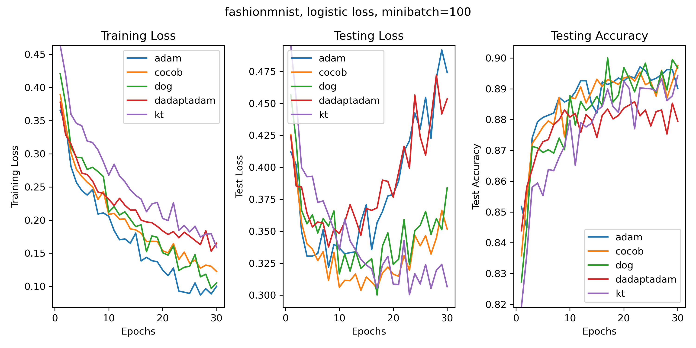
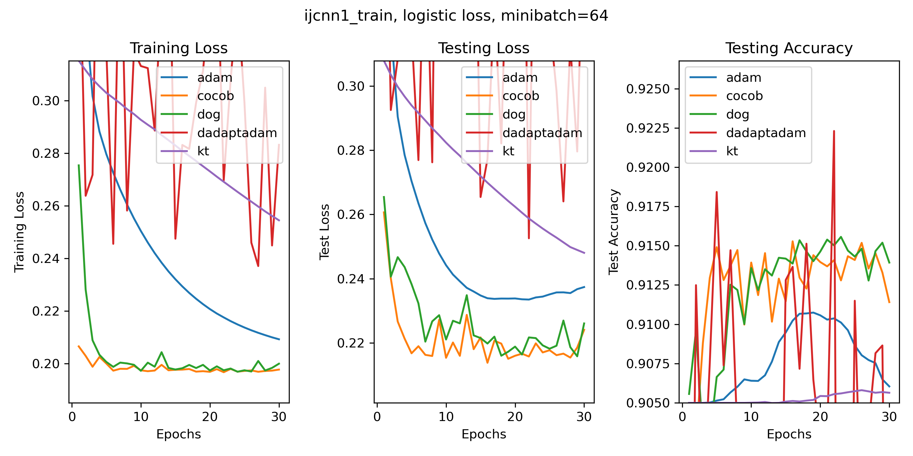

<!--
Copyright (c) 2023, 2024, 2026 Francesco Orabona
Licensed under the MIT License. See LICENSE in the project root.
-->

# Parameter-Free
Parameter-Free Optimizers for PyTorch

This is a library for parameter-free optimization in PyTorch. Parameter-free is a technical term that denotes a certain ability of an optimization algorithm to adapt to the unknown distance to the optimal solution. But in practice it means ``SGD without learning rates'' :)

## Installation
To install the package, simply run `pip install parameterfree`.

## Usage
All the parameter-free algorithms are implemented using the standard PyTorch optimizer interface. After installing with pip, you can simply import and use any of them in your code. For example, to use COCOB, write
```python
from parameterfree import COCOB
optimizer = COCOB(optimizer args)
```
where `optimizer args` follows the standard PyTorch optimizer syntax. 

## Details

There have been many parameter-free algorithms proposed over the past 10 years.
Some of them work very well, even winning Kaggle competitions, some others are mainly interesting from a theoretical point of view.
However, the original code of many of these algorithms got lost or the authors stopped maintaining them.
This also makes it difficult to compare recent algorithms with previous variants.

Moreover, people in this field know that it is possible to combine tricks and reductions, like LEGO blocks, to obtain even more powerful parameter-free algorithms. For example, any online convex optimization algorithm can be made coordinate-wise just running an independent copy on each coordinate.
However, there is essentially no code available, but only long papers full of math :)

So, I decided to write a single library to gather all the parameter-free algorithms I know and possibly of some interesting and easy to obtain variants.
I'll add them slowly over time.
Here the current implemented algorithms:

- **COCOB** This is the first parameter-free algorithms specifically designed for deep learning. The [original code](https://github.com/bremen79/cocob) was in Tensorflow. It was used to win a [Kaggle competition](https://github.com/Arturus/kaggle-web-traffic/tree/master). The paper is 
*Francesco Orabona, Tatiana Tommasi. Training Deep Networks without Learning Rates Through Coin Betting.
 [NeurIPS'17](https://arxiv.org/abs/1705.07795)*

- **KT** First parameter-free algorithm based on the coin-betting framework. Code never released. This is the simplest version of parameter-free algorithms, do not expect state-of-the-art performance. *Warning:* KT might diverge if the stochastic gradients are not bounded in L2 norm by 1, so it is safe to use only with gradient clipping. The paper is 
*Francesco Orabona, Dávid Pál. Coin Betting and Parameter-Free Online Learning.
 [NeurIPS'16](https://arxiv.org/abs/1602.04128)*
 
- **cKT** Coordinate-wise KT. This algorithm appeared for the first time in [my lecture notes on online learning](https://arxiv.org/abs/1912.13213), Section 9.3. Code never released. As for KT, do not expect state-of-the-art performance, this is interesting only from a theoretical point of view. *Warning:* cKT might diverge if the each coordinate of the stochastic gradients are not bounded by 1, so it is safe to use only with gradient clipping with norm=inf.

- **ConicFTRL** Euclidean implementation of Algorithm 4 (Section 8) in
  *Julien Grand-Clément, Joon Kwon, Francesco Orabona.
  [Conic-Lifting for Learning-rate-free Convex Optimization](https://arxiv.org/abs/2610.39531)*.
  It handles unconstrained domains without a supplied gradient bound or horizon.
  The network's parameters at optimizer construction are the anchor. All tensors
  share one lifted scalar coordinate and global gradient-norm statistics.

All the above algorithms support the use of a learning rate decay, see the example file for how to use it. While it is not needed for convex optimization, a learning rate decay allows FTRL-based parameter-free algorithms to provable converge to the minimizer for a large class of **non-convex** functions, as proved in [this paper of mine](https://arxiv.org/abs/2102.00236). The learning rate decay is used in a straightforward way: all the stochastic gradients are multiplied by the learning rate decay before being used by the algorithms, that's it!

If instead of the code you are interested in the theory, a good starting point is the [tutorial](https://parameterfree.com/icml-tutorial/) we gave at [ICML 2020](https://icml.cc/Conferences/2020/Schedule?showEvent=5753).
Note that these are not heuristics, there is a very solid theory behind these algorithms that shows that you can achieve the performance of a tuned SGD or even AdaGrad essentially for free.

### Using ConicFTRL

Create the optimizer after initializing the network and moving it to its device:

```python
from parameterfree import ConicFTRL

model = FashionMNISTModel().to(device)
optimizer = ConicFTRL(model.parameters())
```

The optional `epsilon=1.0` sets the paper's initial loss budget, and `gamma=1.0`
sets its regularization tradeoff. `epsilon` is not a numerical denominator
stabilizer. Optional `weight_decay=0.0` adds an L2 penalty on the network's
parameters. The anchor stays fixed, and is saved along with all algorithm state
by the standard `state_dict()` interface.

Parameters must be dense float32 or float64 tensors on a single device.
Parameter groups share the same conic state; each group's `lr` (initially 1)
scales its gradients before the algorithm uses them. Schedulers work through
this gradient scaling. No gradient clipping is required by the algorithm.
Missing gradients are zero components of the joint gradient, so a parameter
with past nonzero gradients may still move when another tensor's gradient
changes the shared scale. An entirely zero or missing effective gradient leaves
the parameters and algorithm state unchanged.

The vector update solves the scalar equation in Section 8.3 using an exact
quadratic solution on the radius boundary and tightly bracketed Halley steps
otherwise, in Python double precision after a batched scalar transfer to the CPU. The paper's
guarantees are for convex online optimization; this implementation also accepts
gradients from nonconvex neural networks.

### Coordinate-wise algorithms

```python
from parameterfree import CoordinateWise, KT, ConicFTRL

optimizer = CoordinateWise(KT, model.parameters(), w=1e-4)
# Alternatively:
optimizer = CoordinateWise(ConicFTRL, model.parameters(), epsilon=1.0, gamma=1.0)
```

The wrapper runs an independent scalar learner for every weight. It uses batched
tensor operations, with one algorithm instance and no optimizer objects or
Python loops per weight. Each learner anchors at its weight at construction.
`cKT(params, ...)` is a convenience name for `CoordinateWise(KT, params, ...)`.
KT still requires effective L2 gradient norm at most 1 in vector mode, and
absolute effective gradients at most 1 in coordinate-wise mode. Clipping is optional: pass `max_grad_norm=1.0` to KT or cKT (also
`CoordinateWise(KT, ...)`) to apply the usual global L2/Linf clipping inside
the update. The default `None` leaves clipping to the caller. Clipping applies
to raw gradients before decay and gradient scaling, so those transformations
must still respect KT's effective-gradient bound. ConicFTRL requires no clipping.

`w` and `epsilon` are **per-coordinate** budgets. For a total budget `budget`,
pass `w=budget/d` or `epsilon=budget/d`, where
`d = sum(p.numel() for p in model.parameters())`. Parameter groups can specify
different gradient multipliers through `lr` and different L2 weight decay.
They are all declared at construction; the parameter set is fixed.
Parameters must have one dtype (float32 or float64) on one device.

Built-in optimizers follow native PyTorch Adam's storage convention: floating
state uses the parameter dtype. Float32 models use float32 gradients, state,
reductions, and tensor root solves, with no implicit float64 promotion; float64
models use float64 throughout. KT round counters remain int64. The eager vector
ConicFTRL path uses Python scalar arithmetic for its host solve, then stores its
results in the parameter dtype. Custom batched algorithms may define their own
state dtypes. The batched backend does not support float16/bfloat16 parameters.
This policy does not introduce automatic mixed-precision training.

Finite range and rounding now follow the chosen dtype. For example, squaring a
1e20 gradient overflows float32; use float64 parameters when that range is
needed. With default validation, invalid updates raise before committing the
prediction. Disabling validation also disables that protection in tensor updates.

A missing gradient pauses its scalar learners. Explicit zero gradients follow
the base rule: KT advances its round counter; ConicFTRL is a no-op. This changes
the old `cKT` behavior, which skipped explicit zero rounds. Vector KT now applies
the effective gradient, including decay and scheduling, consistently to both
wealth and cumulative gradients, and does not modify `p.grad`.

Coordinate-wise ConicFTRL has full-sized scalar-state tensors and solves all
roots together on the device using the same quadratic solution and three
safeguarded Halley steps on a dimensionless cubic. Horner evaluation reduces
each refinement to one division. Analytical brackets preserve the original
stationarity conditions. Scalar
learners also avoid unnecessary norm reductions. The coordinate-wise version needs more memory and
arithmetic than the vector version. `compile=True` optionally uses
`torch.compile` to fuse packing, zero-gradient masking, the tensor update, and
validation (PyTorch 2+; first use includes compilation). Benchmark it on the target GPU. The default
`error_if_nonfinite=True` checks candidate state before committing it and adds
a CUDA synchronization; set it to `False` to omit the adapter check. The vector
conic algorithm retains its own scalar-state checks.

[conic_speedup.ipynb](benchmarks/conic_speedup.ipynb) embeds the old and new
conic implementations for a before/after GPU comparison in Colab. Its baseline
uses the previous float64-statistics implementation; the new snapshot uses
parameter precision with the same three-step Halley solver. It includes compilation
warmup, trajectory checks, and repeated timing trials. The FashionMNIST Colab
notebook now enables compiled updates by default; set `COMPILE_UPDATES=False`
to compare eager execution. This flag applies to all six methods: COCOB now
supports `compile=True`, and the runner compiles Adam's native `step` callable.
`ERROR_IF_NONFINITE` applies to all repository optimizers, including COCOB;
Adam retains PyTorch's native behavior. Compilation changes execution, not the
optimizer formulas. First-epoch times include compilation for every compiled
method; use later epochs to compare steady-state training speed.

COCOB also accepts these options directly:

```python
optimizer = COCOB(model.parameters(), compile=True, error_if_nonfinite=False)
```

With validation enabled (the default), COCOB checks gradients, predictions,
and candidate state before committing updates, with one CUDA synchronization
per step. Its parameter groups, missing-gradient behavior, and checkpoint
state keys are preserved.

KT and cKT update each model tensor directly, using independent persistent
state buffers. Parameters and gradients are not concatenated each step.
`learner_state` provides a read-only packed snapshot for inspection; packing is
performed only on inspection or checkpoint export. cKT stores its uniform
integer clock once per model tensor, since explicit zero rounds also advance
all its coordinates. Missing gradients pause that tensor's clock. Nonuniform
clocks loaded from a checkpoint retain their full representation.
With `compile=True, error_if_nonfinite=False`, parameter and state writes occur
inside the compiled graph. COCOB similarly updates persistent state buffers in
place. With validation enabled, candidates are checked before any writes.

The FashionMNIST runner uses `max_grad_norm=1.0` for KT/cKT instead of a separate
`clip_grad_norm_` call. For the default unit gradient multiplier and zero decay,
clipping is part of the compiled graph. Other lr/decay settings use external
functional preprocessing to avoid recompiling for every scheduler value.
Gradients stored in `p.grad` are preserved. Supply `max_grad_norm` again when
resuming; it is an execution setting, like compilation and validation.

[kt_speedup.ipynb](benchmarks/kt_speedup.ipynb) compares the previous packed
implementation with direct COCOB/KT/cKT updates and compiled native Adam. It
includes the required KT/cKT clipping, numerical trajectory checks, compilation
warmup, and alternating timing order. Timings cover optimizer steps, rather
than forward/backward computation or a full training epoch.

COCOB, KT, and cKT now select multi-tensor (`foreach`) operations automatically
on CUDA. This exposes independent updates across model tensors to PyTorch's
horizontal fusion, rather than relying on the compiler to recover them from
separate Python iterations. CPU execution keeps the previous per-tensor path
by default. Use `foreach=False` to compare the paths, or `foreach=True` to force
multi-tensor execution on either device. Optimizer formulas, clipping policies,
state precision, and checkpoint layout are unchanged; floating-point rounding
can differ between execution paths. COCOB's foreach path requires one parameter
dtype/device; its default falls back for heterogeneous groups.

The FashionMNIST notebook exposes `FOREACH_UPDATES=None` (automatic CUDA
selection) for these three optimizers; Adam keeps its native automatic selection.
Set `FOREACH_UPDATES=False` for a comparison with the previous implementation.
The ConicFTRL implementations are unchanged. Keep compilation enabled and
per-step validation disabled when measuring throughput, and compare medians
over several warmed-up epochs.

[foreach_speedup.ipynb](benchmarks/foreach_speedup.ipynb) embeds the previous
direct-update implementation and the multi-tensor implementation with native
Adam as reference. Both baseline and candidate include integrated KT/cKT
clipping, persistent state buffers, and the same precision policy. It compares
optimizer-step timings with compilation excluded and checks the resulting
parameters/state. A GPU speed gain is hardware/compiler dependent and must be
measured; equal step speed is not guaranteed by simpler optimizer mathematics.

### Adding algorithms

Implement [BatchedAlgorithm](parameterfree/base.py), then use the same rule in
vector or coordinate-wise mode. No dispatch table or wrapper changes are needed:

```python
import torch
from parameterfree import BatchedAlgorithm, BatchedOptimizer, CoordinateWise

class MyRule(BatchedAlgorithm):
    def __init__(self, rate=0.1):
        self.config = dict(rate=rate)

    def init_state(self, initial_point):
        return dict(anchor=initial_point.clone())

    def update(self, state, point, gradient):
        return state, point - self.config['rate'] * gradient

vector = BatchedOptimizer(model.parameters(), MyRule(rate=0.1))
# Or, on another model:
coordinate = CoordinateWise(MyRule, other_model.parameters(), rate=0.1)
```

Points and gradients have shape `(learners, coordinates)`: `(1, d)` in vector
mode and `(d, 1)` in coordinate-wise mode. Reduce only the last dimension so
learners remain independent. State is a possibly nested dictionary of tensors,
each with the same leading learner dimension. `update` returns new state and
points without modifying its inputs; preserve shapes, dtypes, devices, and
dictionary keys. Keep constructor options in `config` so
`type(rule)(**rule.config)` recreates the rule on checkpoint restoration.
Set `skip_zero_gradients=True` for a zero-round no-op policy. An optional
`is_valid(state)` can return a boolean per learner for additional checks.

For a named optimizer class, subclass `BatchedOptimizer`, set
`algorithm_type = MyRule`, and construct it with an instance of that rule.
`CoordinateWise(MyOptimizer, params, ...)` then works automatically. Ordinary
PyTorch optimizers without this interface are not supported by the wrapper.

Rules can optionally set `supports_tensor_lists=True` for direct coordinate-wise
updates without parameter packing. The same `update` method is applied to
independent state blocks for each model tensor. To optimize a vector rule too, define
`vector_point_state_keys` and the pure `update_vector_blocks` method described
in `BatchedAlgorithm`; KT is an example. Unmodified rules retain the packed
execution path. Both paths use the same checkpoint layout. A vector rule can
optionally supply `update_vector_blocks_foreach` for multi-tensor execution.
A coordinate-wise rule with no special zero-gradient policy can supply
`update_coordinate_blocks(states, points, gradients)`, returning candidate state
and prediction lists for the active tensors. KT provides both examples; rules
without these hooks retain their existing update method.

# Generalization and Parameter-Free Algorithms

It is well-known that the learning rate of the optimization algorithm also influences the generalization performance. So, what happens to the generalization of a deep network trained with a parameter-free algorithm? Well, it is very difficult to say because we do not have a strong theory of how generalization work in deep networks. In general, if your network does not overfit the training data with the usual optimizers, it won't overfit with parameter-free algorithms. However, if your network tend to overfit and you have to set the learning rate carefully to avoid it, parameter-free algorithms might overfit.

From my personal point of view, slowing down the optimizer to increase the generalization performance is a bad idea because you are entangling two different things: optimization and generalization. I instead suggest to use the most aggressive optimization procedure coupled with a regularization method. In this way, the optimizer just has to worry about optimizing functions and the regularizer will take care of the generalization, separating these two aspects.

On the other hand, there is a recent trend on training only for 1-2 epochs on massive datasets. This is particularly true for large language models. It is very easy to show that it is impossible to overfit with only 1 epochs. The reason is that with only 1 epoch you are directly optimizing the *test loss*, together with the training loss. This is not strictly true after the first epoch, but it is still approximately true if the number of epochs is small, let's say 2-3. In this cases, parameter-free algorithms make perfect sense!
 
# Other Parameter-Free Algorithms

Recently parameter-free algorithms have become more popular, especially after the discovery that it is possible to design them in the primal space too.
Here, the links to some other variants for PyTorch.

- **DoG** This algorithm is based on SGD with a parameter-free tuning of the learning rate. (https://github.com/formll/dog)

- **D-Adaptation** Similar to the one above, but this is based on FTRL/DA instead of SGD. (https://github.com/facebookresearch/dadaptation/)
 
# Preliminary Experiments

To compare the vector and coordinate-wise KT/ConicFTRL variants and COCOB with Adam, upload
[fashionmnist_colab.ipynb](examples/fashionmnist_colab.ipynb) to Google Colab,
select a GPU runtime, and run all cells. It embeds the current optimizer sources
and defaults to the network below, 30 epochs, and minibatches of 100. KT and cKT
use their required L2 and Linf gradient clipping; the other methods use unclipped
gradients. The notebook saves training/test loss and test accuracy plots as PNG
and PDF, along with CSV metrics and the run settings. Settings allow smaller
smoke runs or multiple seeds. Embedded snapshots do not update automatically.

The same runner is available locally with
`python -m examples.compare_fashionmnist --device cuda`.

Probably due to the lack of reliable software, a comprehensive benchmark of parameter-free algorithms is missing. I plan to do one and please contact me if you want to help. In the while, here some toy experiments, just to show you that these algorithms do work.

In the following experiments, Adam has the default settings and constant learning rate. Nothing to tune in the others.


FashionMNIST, 2 fully connected hidden layers with 1000 hidden units each and ReLU activations. 

Some classic linear classification experiments too. (If a line does not appear it is because it is outside of the plot. Also, don't be too surprised of the fact that Adam is not so good on convex problems: this is known and probably an effect of the [hypothesis of the co-adaptation of neural networks and optimizers](https://parameterfree.com/2020/12/06/neural-network-maybe-evolved-to-make-adam-the-best-optimizer/) that I have proposed some time ago.)




# License
See the [License file](/LICENSE).

## Development

Install the package with `python -m pip install -e .`, then run the tests with
`python -m unittest discover -s tests -v`.

Optimizer checkpoints use the standard PyTorch `state_dict()` and
`load_state_dict()` interface. 

Note that older KT checkpoints had a bug: they omitted the
optimizer's wealth and iteration counters, so resuming training did not reproduce
the original optimization trajectory. These checkpoints are unsupported and
`KT.load_state_dict()` rejects them. New KT checkpoints save both counters and
support exact continuation.

The batched backend uses a new versioned checkpoint format for KT, cKT,
ConicFTRL, and CoordinateWise. Earlier checkpoints are rejected without
conversion. New checkpoints include the algorithm configuration, tensor state,
anchors, and vector/coordinate-wise layout; loading the wrong algorithm or
layout raises an error. Device changes are supported; dtype and parameter
shapes must match. The current precision-policy version is 2. Version 1 used
float64 wealth/conic statistics even for float32 parameters; those checkpoints
are rejected without conversion so that resuming cannot silently change precision.
